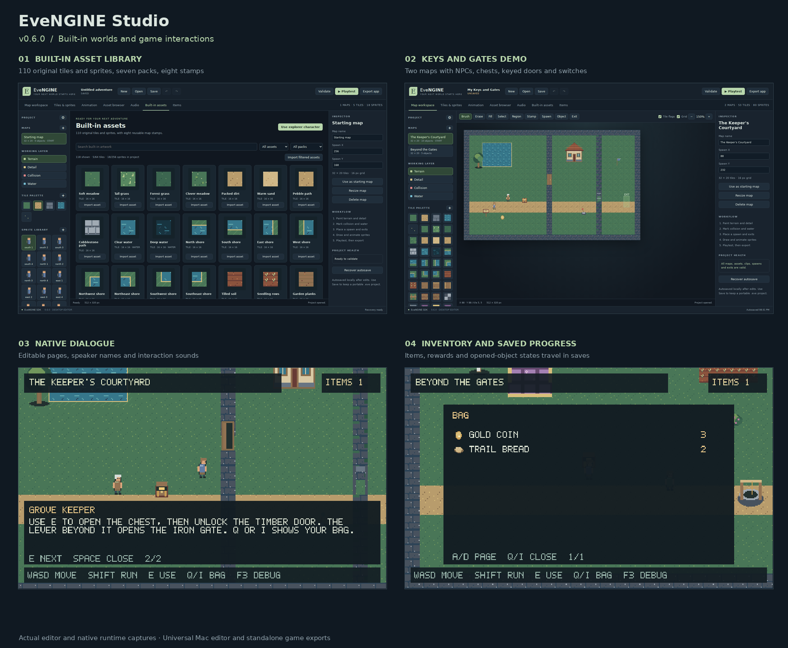

# EveNGINE

EveNGINE is a 2D game engine written in C++, paired with **EveNGINE Studio**, a Mac app for building
top-down adventure games without writing code. You draw maps and artwork, write dialogue and
quests, add music, and export a standalone Mac game. Studio itself needs no terminal, compiler or
Python.

**Current version: 1.0.0** · [Release notes](docs/RELEASE.md) · [Changelog](CHANGELOG.md) · 1.1.0 is in
development on `main`



## Download

Grab the [v1.0.0 release](https://github.com/eve-n37/EveNGINE/releases/tag/v1.0.0):

- **EveNGINE-Studio-v1.0.0-macOS.zip**: Studio, editable templates and a standalone sample game.
- **EveNGINE-Source-v1.0.0.zip**: the source code.

Studio requires macOS 12 or later. Apple Silicon is officially supported. The download also includes
Intel binaries, but Intel support is unofficial. The apps aren't notarized, so the first time you
open one, use Finder's **Open** command or approve it under **System Settings → Privacy &
Security**.

## Quick start

1. Open `EveNGINE-Studio.app`.
2. Choose **New**. Pick **Blank map** or one of the demo templates.
3. Paint terrain, place objects, set a spawn point and add exits between maps.
4. Click **Playtest** to play the current project in the native runtime, even before saving.
5. **Save** keeps a portable `.eve` project. **Export app** builds a standalone Mac game.

Want to see everything working together? Open `editor/examples/Adventure-Candidate.eve`. It has a
branching quest, merchants, a patrolling NPC, combat, events and a custom title screen.
`editor/examples/Frontier-Watch.eve` adds the 1.1 features: equipment, ranged attacks, rival
factions, NPC animations and a timed event.

## What's included

| Area                  | Highlights                                                                                           |
| --------------------- | ---------------------------------------------------------------------------------------------------- |
| **Maps**              | Terrain and detail layers, collision and water, autotiles, object groups, region copy/paste, stamps, world overview |
| **Artwork**           | Pixel editor, animation timeline, PNG and sprite-sheet import, 110 original built-in tiles and sprites, NPC and enemy walk/attack animations |
| **Story**             | Branching dialogue, quests, items, events (including timed events) and story flags, NPC patrols, shops |
| **Gameplay**          | Doors, keys, switches, chests, melee and ranged combat, equipment, factions, health and healing, saved progress |
| **Audio**             | Embedded WAV music and sound effects, per-map music, event cues                                        |
| **Game setup**        | Title and pause menus, player settings, keyboard and gamepad controls, app icon, UI colours            |
| **Engine / SDK**      | Reusable C++ libraries with CMake packages, an SDL3 desktop backend and a headless backend            |

## Documentation

| Guide                                           | What it covers                                           |
| ----------------------------------------------- | -------------------------------------------------------- |
| [Studio guide](docs/STUDIO.md)                  | The editor: maps, artwork, audio, playtesting, exporting |
| [Story guide](docs/STORY.md)                    | Items, interactions, dialogue, quests, events and flags  |
| [Adventure guide](docs/ADVENTURE.md)            | NPC movement, shops, combat and healing                  |
| [Game setup guide](docs/GAME-SETUP.md)          | Menus, controls, app icons and UI colours                |
| [SDK guide](docs/SDK.md)                        | Using the C++ engine in your own projects                |
| [Audio API](docs/AUDIO-API.md)                  | The native audio interface                               |
| [Development guide](docs/DEVELOPMENT.md)        | Building from source, running tests, code formatting     |
| [Legacy starter format](docs/PROJECTS.md)       | The original `.project` / `.scene` text format           |

Test results for each release are in [docs/VALIDATION-1.0.md](docs/VALIDATION-1.0.md) and the
`validation-results/` folder.

## Build from source

On a Mac, install the Xcode Command Line Tools and [CMake](https://cmake.org/download/), then run:

```bash
cmake -S . -B build -DCMAKE_BUILD_TYPE=Release -DCMAKE_OSX_ARCHITECTURES="arm64;x86_64"
```

```bash
cmake --build build --config Release
```

This produces `build/EveNGINE-Studio.app` using the bundled SDL3 framework. The engine also builds
and tests on other systems without a desktop window. See the
[development guide](docs/DEVELOPMENT.md) for that, and for running the tests.

## Repository layout

| Path                 | Contents                                                     |
| -------------------- | ------------------------------------------------------------ |
| `engine/`            | The C++ engine: core, platform backends, Studio game runtime |
| `editor/native/`     | The macOS Studio app shell (AppKit + WebKit)                 |
| `editor/ui/`         | The editor interface (HTML, CSS, JavaScript)                 |
| `editor/runtime/`    | The game runtime used for playtests and exports              |
| `editor/assets/`     | Built-in artwork and the script that generates it            |
| `editor/examples/`   | Example `.eve` projects                                      |
| `editor/tests/`      | Model, runtime, loader and UI tests                          |
| `starter/`           | A minimal C++ game that uses the SDK directly                |
| `tools/`             | Atlas packing and Mac packaging scripts                      |
| `docs/`              | Guides and validation reports                                |

## Compatibility

Projects from earlier versions open in 1.0. Older `.lota` project files still load, and new saves
use `.eve`. The engine's original names are kept for compatibility: the `LotAEngine` CMake package,
`LotA::` targets, `<lota/...>` headers and the `lota` namespace all still work. New code should use
`EveNGINE`, `EveNGINE::` targets, `<evengine/...>` headers and the `evengine` namespace.

## License

The original code, artwork, examples and documentation are MIT-licensed; see [LICENSE](LICENSE).
Third-party components keep their own licenses; see [third_party/](third_party/).
