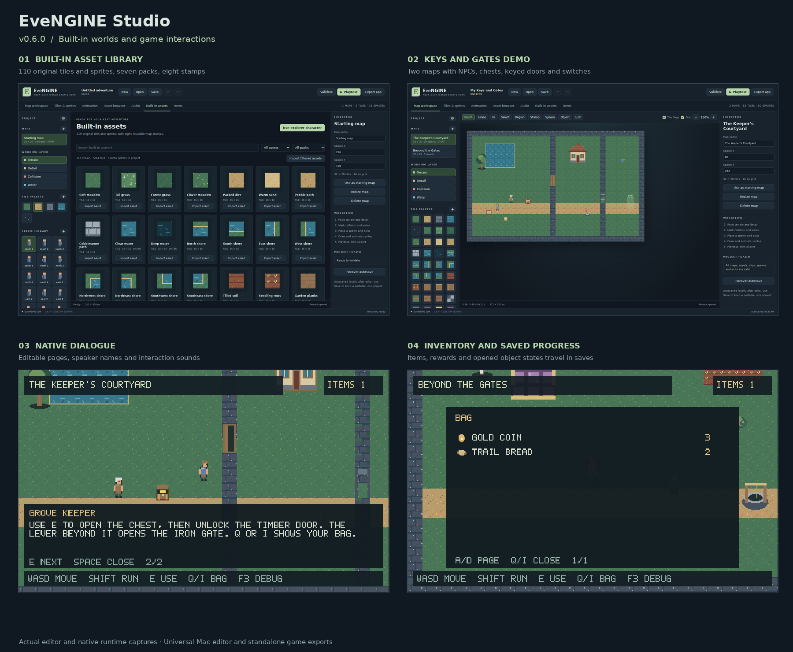

# EveNGINE 0.7.0 — EveNGINE Studio

**v0.7.0 development build:** branching dialogue, quests, a journal, game icons, and editable UI colors. See [the appearance guide](docs/APPEARANCE.md), [the story guide](docs/STORY.md) and [changelog](CHANGELOG.md). The published GitHub release below remains v0.6.0.

A reusable 2D C++ engine with a separate GUI authoring app. Requires macOS 12 or later; universal Apple Silicon / Intel binaries are included. Normal editing and app export do not require a terminal, Python, Xcode or a compiler.

## Downloads

Get the [first public release](https://github.com/eve-n37/EveNGINE/releases/tag/v0.6.0). Download **EveNGINE-Studio-v0.6.0-macOS.zip** for the editor and playable samples, or **EveNGINE-SDK-v0.6.0.zip** for the source and prebuilt SDK. The repository contains source and the bundled SDL3 framework; prebuilt apps and installed libraries are in the release downloads.



## Start here

These paths refer to the downloaded SDK. In the Studio download, open `EveNGINE-Studio.app` directly.

1. Open `macOS/EveNGINE-Studio.app`.
2. Choose **New → Keys and Gates** to try the new interactions, or start a blank map.
3. Paint terrain, detail, collision and water. Place objects, a spawn and exits.
4. Use **Built-in assets** for ready-made artwork or **Asset browser** to import tilesets or sprite sheets; double-click artwork to draw it. Use **Animation** to arrange frames.
5. Use **Region** to copy map areas and save stamps. Add music and event sounds in **Audio**.
6. Click **Playtest** to run the current map in the native C++ runtime.
7. Click **Save** to keep a portable `.eve` project; click **Export app** to produce a standalone Mac application.

`macOS/Keys-and-Gates.app` is the new interaction demo; its editable source is `editor/examples/Keys-and-Gates.eve`. `macOS/Mosslight-Example.app` is the original standalone sample export. `editor/examples/Mosslight.eve` is its editable source. `docs/STUDIO.md` is the user guide.

If macOS blocks a downloaded development app, use Finder's Open action or the approval shown in Privacy & Security. These builds are development binaries and are not notarized. The owner reports successful Mac use on Apple Silicon; Intel execution remains untested.

## Included

- Story tools: branching conversations, conditional choices, four quest objective types, one-time rewards, and a saved journal. Try **New → Story demo · the keeper’s errand**.
- Built-in assets: 110 original pixel-art tiles/sprites, seven packs, eight map stamps and a four-direction explorer preset.
- Interactions: NPC dialogue, inventory items, pickups, reward chests, keyed doors and linked latch switches, with saved progress.
- Asset browser: name/ID/group search, type and group filters, artwork inspection, duplicate and reference-aware deletion.
- PNG sheet importer: tile/sprite grids with cell size, margins, spacing, alpha, palette matching and optional animation assignment.
- Map regions and stamps: four-layer copy/cut/paste, reusable stamps, rectangular rotation and flips, and cross-map placement.
- Audio editor: embedded PCM WAV clips, preview, looping map music, seven interaction/event cues and separate music/effects volume.
- Map editor: terrain and detail layers, collision/water painting, fill/erase, grid and zoom, map creation/resizing, spawn points and exits.
- Pixel editor: pencil, eraser, fill, eyedropper, rectangular selection, copy/paste, palettes, transparency, flips, square rotation, PNG import/export, seamless tile previews.
- Animation editor: directional walk, idle and attack clips, timeline, frame timing/reordering, live preview and onion skinning.
- Inspector: object position, sprite, collider, sign text, behaviour and exit destinations.
- Project templates, native open/save, object templates, bounded undo/redo, autosave/recovery and validation.
- Playtest, debug overlays and export with the same C++ scene data used by the game runtime.
- Engine source, universal Mac SDK libraries, CMake targets and regression tests.

The editor uses macOS AppKit and its built-in WebKit view. Exported games contain the native engine, SDL3 and their project data. They do not contain the editor or require a browser.

## Project scope

Studio projects use a new editable `.eve` format. It does **not** import the current LotA RPG's baked world atlas or Godot scenes. The existing LotA game remains unchanged. Migrating its maps, RPG rules and UI into Studio is a follow-up task. The generic runtime supports exploration, collectibles, dialogue, inventory, chests, doors and switches. Shops, RPG data and UI layout editors are future modules. Quests and branching dialogue are optional v0.7.0 features. 3DS authoring/export remains paused.

## Build from source

On Mac, install Xcode Command Line Tools and CMake, then:

```sh
cmake -S . -B build -DCMAKE_BUILD_TYPE=Release -DCMAKE_OSX_ARCHITECTURES="arm64;x86_64"
cmake --build build --config Release
```

Open `build/EveNGINE-Studio.app` (or the generator's Release directory). The bundled SDL3 framework is used. The C++ runtime is also buildable headlessly on other systems:

```sh
cmake -S . -B build-headless -DLOTA_DESKTOP=OFF
cmake --build build-headless
ctest --test-dir build-headless --output-on-failure
```

A Linux desktop build needs SDL3 3.2+ installed. The native GUI in this milestone is Mac-only. The HTML editor workspace can be opened separately for portable drawing and project saving, but native playtesting/export require the Mac app.

## Reuse the SDK

For the published v0.6.0 SDK, point `CMAKE_PREFIX_PATH` to its `macOS` directory and use:

```cmake
find_package(EveNGINE 0.6 CONFIG REQUIRED)
add_executable(my-game main.cpp)
target_link_libraries(my-game PRIVATE EveNGINE::Core EveNGINE::Platform EveNGINE::Studio)
```

`EveNGINE::Studio` is an optional, data-driven exploration module. Its public API is in `include/evengine/studio.hpp`. Other genres can link only the core/platform targets and define their own rules. The original C++ starter remains available under `starter` and in `macOS/EveNGINE-SDK-Starter.app`.

For a v0.7.0 SDK built from this source, run `cmake --install build --prefix sdk`, point `CMAKE_PREFIX_PATH` to `sdk`, and request `find_package(EveNGINE 0.7 CONFIG REQUIRED)`.

See `VALIDATION.md` for the checks and their limits. Third-party notices are in `third_party`.

## Compatibility

Existing `.lota` projects, their IDs and progress remain compatible. New files use `.eve`; both extensions open in EveNGINE Studio. The original `LotAEngine` CMake package, `LotA::` targets and `<lota/...>` headers remain compatibility entry points. New code can use `EveNGINE`, `EveNGINE::` targets and `<evengine/...>` headers with the `evengine` namespace. Recovery continues to use the existing Application Support location.

Original code, artwork, examples and documentation are MIT-licensed; see LICENSE. Third-party components retain their licenses.
